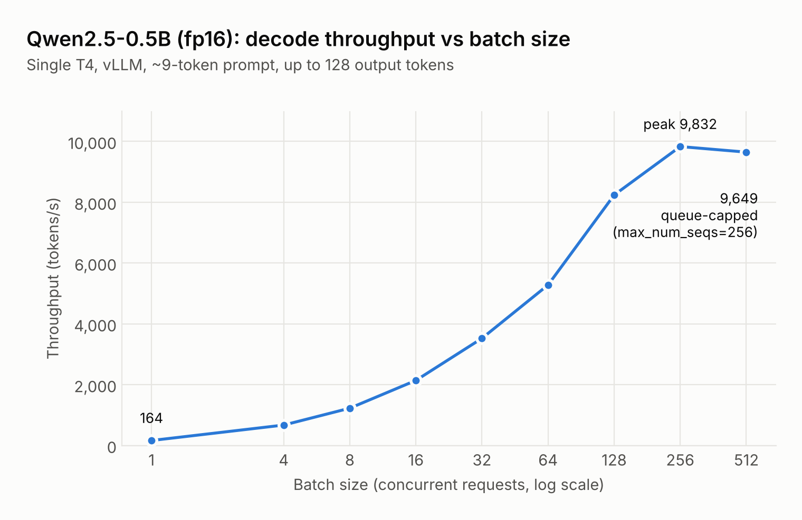
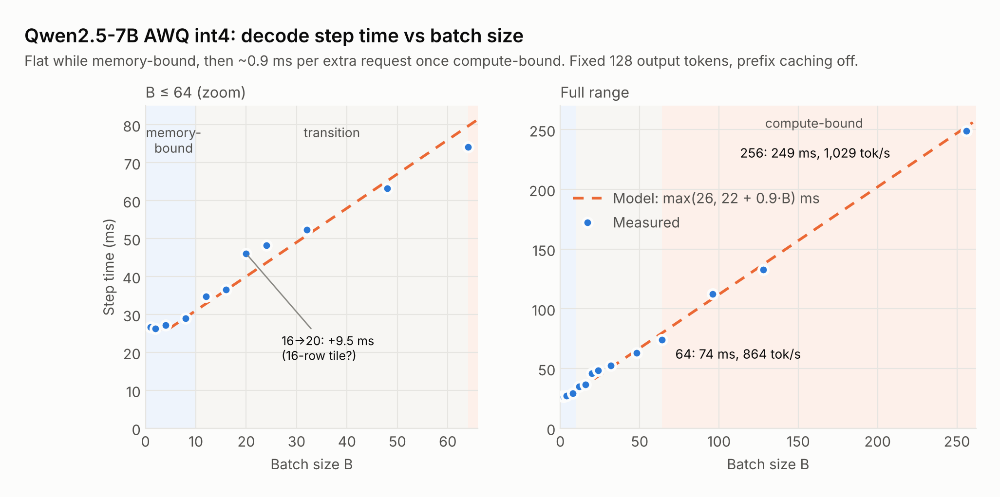
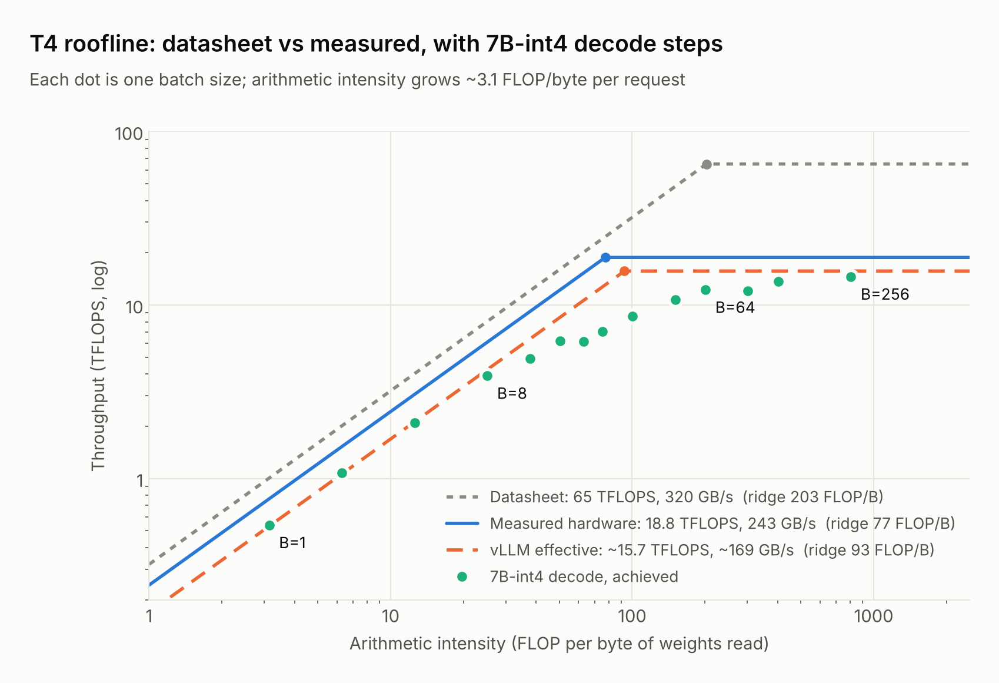
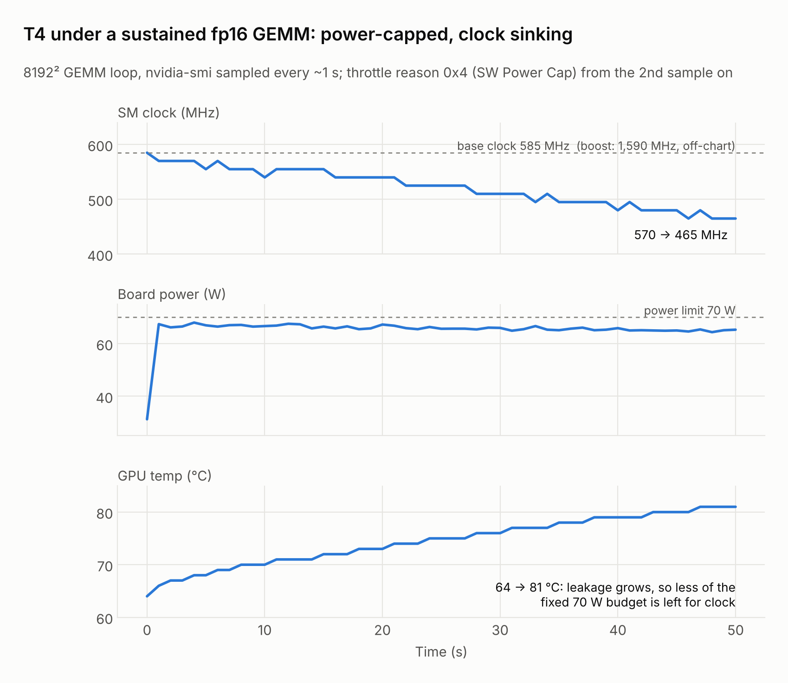

# LLM Inference Performance Analysis on a Single NVIDIA T4

A hands-on study of LLM inference performance with vLLM. The focus is not
just *measuring* throughput and latency, but *explaining* the mechanisms
behind them, down to the hardware.

## TL;DR

On a single T4 (15 GB), I benchmarked and analyzed:

- **Continuous batching**: 13.6× faster than serial requests, with only 20
  requests.
- **Throughput saturation**: the 0.5B model's gains flatten near batch 256
  (~9,800 tok/s).
- **Where decode actually saturates**: for 7B int4, step time starts rising at
  **B ≈ 8–12** and is linear (compute-bound) past B ≈ 64. That is ~3× earlier
  than even a calibrated roofline predicts.
- **`sm%` is misleading**: it reads 100% even at batch 1. Saturation has to be
  read from step-time scaling.
- **The T4 is power-bound**: under sustained GEMM it runs at ~1/3 of its boost
  clock (70 W cap), delivering **18.8 of its 65 datasheet TFLOPS**.
- **Quantization**: AWQ int4 makes a 7B model fit (~15 GB fp16 → 5.3 GiB). It
  helps memory and small-batch latency, not compute.
- **Prefix caching limits**: no measurable benefit on short prompts, and the
  structural reasons why.

Each result is tied back to a specific mechanism: continuous batching,
PagedAttention, prefill/decode asymmetry, GEMM arithmetic intensity, or GPU
power management.

---

## 1. Background & Goal

Serving LLMs efficiently is fundamentally a systems problem. The model is
fixed, but how you schedule requests, manage GPU memory, and use the hardware
decides whether you serve 100 or 10,000 users on the same card.

This project analyzes those trade-offs empirically on a single, modest GPU
(T4, 15 GB), with vLLM as the serving engine. The emphasis is on connecting
**observed performance** to the **mechanisms** that produce it. The goal is
understanding *why*, not just collecting numbers.

## 2. Environment & Methodology

**Hardware / Software** (full details in [`ENVIRONMENT.md`](ENVIRONMENT.md))

- GPU: NVIDIA T4 (15 GB, compute capability 7.5, 70 W), single card, Google Colab
- Engine: vLLM 0.34.0
- Models: Qwen2.5-0.5B-Instruct (fp16), Qwen2.5-7B-Instruct-AWQ (int4)
- Prefix caching: set per experiment (on in §3.2–3.3, off in §4)

**Benchmark discipline.** Inference numbers mean nothing without full
context, so every measurement reports:

- **Model + precision** (0.5B fp16 / 7B int4)
- **Input length** (prompt tokens, which drive prefill / TTFT)
- **Output length** (`max_tokens`, which drives decode / E2E / throughput)
- **Batch size** and **sampling parameters**

Additional practices:

- **Warmup**: every timed run follows an untimed warmup call. This excludes
  one-time costs (kernel compilation, allocation, cache population) and
  reflects steady-state performance, which is what a warmed-up server
  delivers.
- **Controlled variables**: when isolating one factor, all others are held
  fixed.
- **Fixed output length for scaling studies**: `ignore_eos=True`, so every
  request runs exactly `max_tokens` steps and the batch never shrinks during
  a run (§4).
- **Raw data is published**: every table and figure is generated from
  [`results/raw/`](results/raw) by [`scripts/plot.py`](scripts/plot.py).

---

## 3. Experiments & Findings

### 3.1 Continuous Batching: Serial vs Batched

**Setup**: 20 identical requests, submitted serially (one `generate` call
each) vs batched (one call with all 20).

| Mode | Time | Speedup |
|---|---|---|
| Serial (20× single) | 13.8 s | 1× |
| Batched (1× of 20) | 1.0 s | **13.6×** |

**Why**: vLLM uses *continuous batching*, scheduled at the granularity of a
single **decode step** (one forward pass that generates one token for every
active request in the batch). After each step, the scheduler checks each
request. If it emitted EOS or hit `max_tokens`, it is evicted and its result
returned, and the freed slot is immediately filled by a queued request.

This removes the two sources of waste in serial execution:

1. **Fixed per-call overhead** (scheduling, kernel launch) is paid once for
   the whole batch instead of 20 times.
2. **GPU under-utilization**: a single request's decode step computes only
   one token. That is a matrix-vector product that streams every weight from
   memory to use it once (§4.1). Batching 20 requests reuses each weight read
   20 times.

**Production takeaway**: never serve requests one at a time. Continuous
batching is the single biggest lever for inference throughput. It is also why
more concurrent requests *increase* per-request efficiency instead of
degrading it.

### 3.2 Throughput vs Batch Size

**Setup**: Qwen2.5-0.5B (fp16), ~9-token prompt, `max_tokens=128`
(EOS allowed), temperature 0.8, `max_num_seqs=256`. Batch size swept from 1
to 512; each point is warmed up, then timed.

| Batch | Throughput (tok/s) | Time/req, amortized (ms)* |
|------:|-------------------:|--------------------------:|
| 1 | 164 | 401 |
| 4 | 672 | 191 |
| 8 | 1,227 | 103 |
| 16 | 2,140 | 59 |
| 32 | 3,525 | 35 |
| 64 | 5,280 | 23 |
| 128 | 8,238 | 15 |
| 256 | **9,832** ← peak | 13 |
| 512 | 9,649 | 13 |

\* `total_time / batch_size`. This is **not** per-request latency; see the
note below.



**Observation**: throughput climbs steeply, then flattens. Going from 128 to
256 doubles the batch for only +19% throughput, so the GPU is approaching its
compute ceiling. The 512 point is **not** evidence of saturation:
`max_num_seqs=256` caps concurrency, so at 512 the same 256 requests run
while the rest wait in the queue (~330 ms queueing measured). Separating the
configuration limit from the hardware limit needs a run with
`max_num_seqs=512`. The step-time method in §4 reads saturation directly.

**Why it rises, then flattens**: at small batch, decode is memory-bound.
Every step streams all weights from DRAM, and a few tokens can't use the
compute that read pays for, so each added request is nearly free. As the
batch grows, the same weight read is shared by more tokens, until compute
(not memory) becomes the limit (§4).

**Why 256 requests fit at all**: vLLM's **PagedAttention** splits the KV
cache into fixed-size blocks allocated on demand (like OS virtual-memory
paging), instead of reserving a contiguous max-length region per request.
Naive max-length reservation would have exhausted the card long before 256
requests. With paging, these short sequences used only ~3% of the KV pool,
so memory was never the constraint in this benchmark.

**On the "time/req" column: latency definitions.** Three distinct latency
metrics matter in serving, and they are not interchangeable:

- **TTFT** (time to first token): submit → first token. Driven mainly by
  *input* length (prefill cost).
- **E2E latency**: submit → last token. Driven mainly by *output* length
  (decode cost).
- **TPOT** (time per output token): the average interval between tokens.

The "time/req" column is none of these. It is `total_time / batch_size`, an
amortized figure equal to the inverse of throughput. Batched requests run
**in parallel**, so each request's real E2E is roughly the batch wall-clock
time, not this number. Only the batch = 1 row (401 ms) reflects true
single-request E2E. The shrinking numbers show improving *efficiency*, not
faster individual responses.

**Production takeaway**: throughput and latency are different, often opposing
goals. Large batches maximize throughput (offline jobs). Small batches or
first-token optimization minimize latency (interactive serving). Any
saturation point is specific to its configuration: longer inputs or outputs,
a different model, or a different precision all move it.

### 3.3 Prefix Caching: When Does It Actually Help?

**Setup**: Qwen2.5-0.5B (fp16), prefix caching on, 256 requests per run, 128
output tokens. "Same" = 256 copies of one short prompt (~9 tokens);
"different" = 256 prompts with a varying index (`"写第{i}首关于春天的诗"`).

| Prompts | Relative time (different / same) |
|---|---|
| 256 identical vs 256 different | **0.97–1.03×** (no measurable gain) |

**Why — two independent reasons, either one is enough:**

1. **Nothing was eligible to be cached.** vLLM stores the KV cache in fixed
   blocks (16 tokens by default) and prefix caching works at block level:
   it hashes only *completely filled* blocks and lets requests share them.
   A ~9-token prompt never fills a block, so there was no shared block to
   reuse. The feature was enabled, but it had nothing to work on.
2. **Prefill was a negligible part of the work anyway.** Each request does one
   prefill pass over ~9 tokens, then 128 sequential decode steps. Even a
   perfect cache would save well under 1% of the steps. On a 0.5B model the
   prefill pass is also very cheap in absolute terms.

**When it does help**: the saving is roughly
`shared_prefix_tokens × 2 × params` FLOPs per request, and it shows up as
lower **TTFT** (time to first token), not as faster decode. It pays off when
the shared prefix is long relative to the output: long system prompts,
few-shot examples, multi-turn chat (each turn re-sends the history), RAG over
a repeated document, and agent loops that re-send the same tool definitions.

**Production takeaway**: prefix caching is close to free to enable, but judge
it by TTFT on prompts with a long shared prefix. A short-prompt throughput
benchmark will always show "no effect" for structural reasons, and that says
nothing about its value for a 2,000-token system prompt.

> *Optional follow-up*: 7B-AWQ with a ~1,000-token shared system prompt,
> comparing TTFT with caching on and off.

### 3.4 Quantization: Fitting a 7B Model on a 15 GB Card

**Setup**: Qwen2.5-7B-Instruct-AWQ (4-bit weights, fp16 activations). vLLM
chooses the **Marlin** w4a16 kernel on the T4.

| | fp16 (estimated) | AWQ int4 (measured) |
|---|---|---|
| Weight memory | ~15.2 GB → **does not fit** | **5.29 GiB** |
| KV cache available | — | 6.45 GiB (~105k tokens) |
| Decode, batch 1 | — | **38 tok/s** (26.6 ms/step) |
| Decode, batch 256 | — | ~1,030 tok/s |

**Why 5.3 GiB and not 3.5 GB.** A naive "7.6B × 0.5 bytes" estimate gives
3.8 GB. AWQ quantizes only the transformer linear layers. The input embedding
and `lm_head` (152k vocab × 3,584 hidden, untied) stay in fp16, about 1.09 GB
each, and the int4 groups carry fp16 scales and zero-points. Averaged over
the weights actually read during decode, this is **~0.64 bytes/param**, not
0.5.

**What w4a16 does and does not buy:**

- **It saves memory and bandwidth.** Weights are stored as int4 and expanded
  to fp16 inside the kernel, in registers. Each decode step therefore reads
  ~4× fewer weight bytes, which is exactly what matters in the memory-bound
  regime (small batch, latency-sensitive).
- **It does not save compute.** The multiply-adds still run in fp16 on the
  Tensor Cores, plus the extra dequantization work. In the compute-bound
  regime, Marlin's marginal rate (~15.7 TFLOPS) is ~84% of a plain fp16 GEMM
  (§4).
- **It moves the knee earlier.** Fewer bytes per FLOP means the GPU runs out
  of compute at a smaller batch. On paper the balance batch drops 4×
  (203 → 51 on datasheet numbers). In practice the 7B-int4 curve starts
  bending at B ≈ 8–12 (§4).

**KV cache budget.** Qwen2.5-7B uses GQA (28 layers, 4 KV heads, head dim
128): 2 × 28 × 4 × 128 × 2 bytes = **56 KiB per token**. The 6.45 GiB left
after weights holds ~105k tokens, or ~100 concurrent requests at the full
1,024-token context. With short benchmark sequences (~136 tokens) KV
capacity was never the limit.

**Production takeaway**: weight-only int4 is a **capacity and latency** tool.
It lets a model fit on a card it otherwise wouldn't, frees memory for KV
cache, and speeds up small-batch decode. It is not a throughput tool at
high batch. To raise the compute ceiling you need lower-precision *compute*
(W8A8 / FP8, where the hardware supports it) or a bigger GPU.

### 3.5 0.5B fp16 vs 7B int4

| | Qwen2.5-0.5B fp16 | Qwen2.5-7B AWQ int4 |
|---|---|---|
| Params (matmul FLOPs/token) | 0.49B (~1 GFLOP) | 7.6B (~14 GFLOP) |
| Weight memory | ~1 GB | 5.29 GiB |
| KV cache / token | 12 KiB | 56 KiB |
| Decode, batch 1 | 164 tok/s (~6 ms/step) | 38 tok/s (26.6 ms/step) |
| Peak throughput | 9,832 tok/s @ B=256 | ~1,030 tok/s @ B=256 |
| Theoretical balance batch (datasheet) | 203 | 51 |

> The 0.5B sweep used variable output lengths (EOS allowed) and prefix
> caching on. The 7B sweep fixed output at 128 tokens (`ignore_eos`) with
> caching off. Compare the shapes of the two curves, not exact percentages.

**Observations:**

- **Batch 1 is memory-bound for both models, at a similar efficiency.** At
  batch 1 the 0.5B model streams ~1 GB in ~6.1 ms (~160 GB/s) and the 7B
  model streams ~4.5 GB in 26.6 ms (~169 GB/s). Both reach roughly 2/3 of
  the 243 GB/s copy bandwidth, which points to a fixed per-step overhead
  rather than a model-specific problem.
- **Peak throughput ratio (~9.5×) roughly tracks the FLOPs ratio (~14×).**
  The large model loses less to fixed overhead per FLOP, but it is limited
  by the same power-capped compute ceiling.
- **The small model keeps scaling much further** (useful batch into the
  hundreds), because fp16 weights move its balance point 4× later than int4.

**Production takeaway**: model choice sets the whole operating curve.
Measure the curve for the model you will actually deploy. Saturation points
do not transfer between model sizes or precisions.

---

## 4. Bottleneck Analysis: Where Does Decode Saturate?

### 4.1 Prefill vs decode, in matrix terms

Almost all inference FLOPs are in the linear layers (QKV/output projections,
MLP, `lm_head`). Each one is a GEMM:
`[tokens_this_step × d_in] × [d_in × d_out]`. Every row is one token. Rows
can come from different requests and different phases (vLLM's chunked prefill
mixes decode tokens and prefill chunks in one step), because each row is
multiplied independently against the same weights.

- **Prefill**: the prompt is known in advance, so one request contributes
  hundreds of rows. Each weight read is reused many times, so prefill is
  **compute-bound**.
- **Decode**: autoregressive, so each request contributes **one row per
  step**. At batch 1 the GEMM degenerates to a matrix-vector product (GEMV):
  every weight is read from DRAM and used once, so decode is
  **memory-bound**. Batching B requests reuses each weight read B times.
  This is the mechanism behind every batching gain in §3.

Each weight contributes one multiply-add per token (2 FLOPs), hence
**FLOPs/token ≈ 2 × params**. This excludes attention over the KV cache,
which is negligible at the short contexts used here.

### 4.2 `sm%` is the wrong saturation signal

`nvidia-smi dmon` reported **sm = 100% at every batch size, including B=1.**
NVML's SM utilization is a *time* metric: the fraction of the sample window
in which any kernel was running. Decode launches kernels back-to-back, so the
GPU looks "fully busy" even when it is purely memory-bound. Saturation has to
be read from how **step time** scales with batch size:

- memory-bound: each step streams the weights once → step time flat,
  throughput ∝ B
- compute-bound: step time grows linearly with B → throughput plateaus

### 4.3 Step-time sweep (7B AWQ)

**Setup.** Single T4, vLLM 0.34.0 (Marlin w4a16, Triton attention, CUDA
graphs). ~8-token prompt, **fixed 128 output tokens** (`ignore_eos=True`),
temperature 0.8, prefix caching off. All B requests run as one batch, so
step time ≈ wall time / 128.

| B | tok/s | step (ms) |
|---:|---:|---:|
| 1 | 38 | 26.6 |
| 4 | 148 | 27.1 |
| 8 | 276 | 29.0 |
| 16 | 438 | 36.5 |
| 32 | 612 | 52.3 |
| 64 | 864 | 74.1 |
| 128 | 964 | 132.8 |
| 256 | 1029 | 248.7 |



Three regimes:

- **B ≤ 8, memory-bound.** Step time ~26–29 ms; throughput scales ~linearly.
- **B 12–64, transition.** Step time rises, throughput still grows.
- **B ≥ 64, compute-bound.** Each extra request adds ~0.9 ms/step. 4× more
  batch (64 → 256) buys only +19% throughput at 3.4× the latency.

### 4.4 Four rooflines

| Layer | Compute | Bandwidth | Balance (FLOP/B) | Balance batch |
|---|---|---|---:|---:|
| Datasheet | 65 TFLOPS | 320 GB/s | 203 | 51 (pure int4) |
| Hardware microbench¹ | 17.5–18.8 TFLOPS | 243 GB/s | ~75 | 18–23² |
| vLLM effective (derived)³ | ~15.7 TFLOPS | ~169 GB/s | 93 | ~30 |
| Observed curve | — | — | — | bends at 8–12, linear ≥ 64 |

¹ `torch` 8192² fp16 GEMM, and a 512 MB device-to-device copy (read + write),
both with explicit `torch.cuda.synchronize()`.
² 18 for pure int4 (0.5 B/param); 23 using the real ~0.64 B/param (§3.4).
³ Not measured directly: derived from step times. Bandwidth = ~4.5 GB of
weights per step / 26.6 ms at B=1. Compute = ~14 GFLOP per token / 0.9 ms
marginal step cost.



### 4.5 Interpretation

1. **The T4 is power-bound, not silicon-bound.** During a sustained 8192²
   fp16 GEMM, `nvidia-smi` reported throttle reason `0x4` (SW Power Cap):
   power held at ~65–68 W against the 70 W limit while the SM clock fell
   from 570 to 465 MHz (~510 MHz average). That is ~1/3 of the 1,590 MHz
   boost clock and below the 585 MHz base clock. The clock kept dropping at
   constant power as the die heated from 64 °C to 81 °C, because leakage
   grows with temperature and eats into the fixed budget. At 510 MHz the
   theoretical peak is ~20.9 TFLOPS; the measured 18.8 TFLOPS is ~90% of
   that. **Nearly all of the 65 → 18.8 TFLOPS gap is throttling, not kernel
   inefficiency.** The high kernel efficiency is partly a side effect:
   memory clocks are not throttled, so a slowed SM is easier to feed.

   

2. **On compute, vLLM is close to the hardware ceiling.** The marginal rate
   (~15.7 TFLOPS) is ~84% of the fp16 GEMM ceiling. The remaining gap is
   consistent with Marlin's extra dequantization work. The ~1,030 tok/s
   plateau is effectively the ceiling for this model on this GPU.
3. **On bandwidth, ~30% is left on the table** (169 vs 243 GB/s), and only at
   small batch. Each step spends ~8 ms beyond pure weight streaming. Likely
   contributors, not yet profiled: many small per-layer kernels (norms, RoPE,
   activations, attention), sampling over a 152k vocab (FlashInfer's sampler
   is unavailable on compute capability 7.5), per-step scheduling on the
   CPU, and Marlin's efficiency at M=1. The 0.5B model shows the same ~2/3
   efficiency (§3.5), which fits a fixed per-step overhead.
4. **Memory and compute add up instead of overlapping.** A pure roofline
   predicts `step = max(T_mem, B·t_c)`, flat until B ≈ 30. The data fits
   `step ≈ max(26, 22 + 0.9·B)` ms much better: compute cost starts adding
   from B ≈ 8. Real kernels don't fully hide one behind the other, so **the
   practical knee is ~3× earlier than even the effective roofline
   suggests.**
5. **Possible 16-row staircase (hypothesis).** B = 16 → 20 costs +9.5 ms
   while throughput drops slightly (438 → 435). B = 64 → 96 also dips
   (864 → 853). This is consistent with Marlin tiling the batch (M)
   dimension in blocks of 16. To verify: B = 16/17, 32/33, 64/65.

### 4.6 Takeaways

- Find the saturation point from the **step-time curve**, not from `sm%` and
  not from the datasheet.
- On a T4 with a 7B int4 model, **B ≈ 8–16** captures most of the batching
  win at near-minimal latency. Past B ≈ 64 you trade latency for
  single-digit throughput gains.
- Calibrate any roofline with two microbenchmarks (GEMM + copy) and check
  clocks under load before using it for capacity planning.

---

## 5. Pitfalls & Lessons Learned

Most of these produced a plausible-looking but wrong number before they
were caught.

1. **"Latency" is three different metrics.** TTFT (time to first token),
   TPOT/ITL (time per output token), and E2E request latency move
   differently with batch size. Dividing batch time by batch size gives an
   *amortized* number that no user experiences. Every benchmark must state
   input length, output length, and which latency it reports.
2. **Variable output lengths corrupt step-time comparisons.** With EOS
   allowed, requests finish at different times and the effective batch
   shrinks during the run. Use `ignore_eos=True` with a fixed `max_tokens`
   when measuring scaling.
3. **Prefix caching plus identical prompts confound throughput tests.**
   Disable caching, or vary the prompts, unless caching is the thing being
   measured.
4. **vLLM memory is invisible to `torch.cuda.*`.** The engine runs in a
   separate EngineCore process. `nvidia-smi` shows the reserved pool
   (`gpu_memory_utilization` × total), not what is in use. Real KV usage
   comes from vLLM's logs and metrics (~3% in the 0.5B runs).
5. **Queueing is not hardware saturation.** The 7B batch-512 run queued for
   8.5 s because `max_num_seqs=256` caps concurrency. That is a scheduler
   limit, not the GPU running out of capacity.
6. **`sm%` = 100% does not mean compute-bound** (§4.2).
7. **Datasheet TFLOPS are unreachable on a power-capped card.** The T4
   sustained ~1/3 of its boost clock under GEMM load (§4.5). Check
   `clocks_throttle_reasons` before trusting any roofline.
8. **GPU timing is asynchronous.** Kernel launches return immediately.
   Microbenchmarks need `torch.cuda.synchronize()` before reading the clock,
   plus a warmup pass.
9. **Older GPUs silently lose fast paths.** On compute capability 7.5, vLLM
   logged that FlashAttention 2 (needs ≥ 8.0) and the FlashInfer sampler were
   unavailable, and fell back to Triton attention and a slower sampler.
   Read the engine's startup log: it tells you which kernels you are
   actually benchmarking.
10. **7B fp16 does not fit on a 15 GB card** (~15.2 GB of weights alone, with
    nothing left for KV cache). Quantization was required, not optional.

---

## 6. Production Implications

- **Always batch.** Continuous batching gave 13.6× at only 20 requests. It
  is the largest single lever, and it is free.
- **Size `max_num_seqs` from the latency SLO, not from memory.** For 7B-int4
  on a T4, B = 16 means ~37 ms/token (~27 tok/s per user), B = 64 means
  ~74 ms (~13.5 tok/s, around reading speed), and B = 256 means ~250 ms
  (~4 tok/s, too slow for interactive chat). Memory would allow more; the
  SLO shouldn't.
- **Plan capacity from measured curves.** Use a microbenchmark-calibrated
  roofline with real clocks under load. On power-capped inference cards,
  datasheet numbers overestimate sustained compute by ~3×.
- **Know what your quantization buys.** Weight-only int4 buys memory and
  small-batch latency. Throughput at scale needs low-precision compute or
  more hardware.
- **Turn on prefix caching for long shared prefixes,** and evaluate it by
  TTFT on realistic prompts.
- **Monitor the right signals.** Track TTFT/TPOT percentiles, queue time, KV
  cache usage, and GPU clocks and throttle reasons. "GPU utilization %" is
  near-useless for inference.
- **Check which kernels the engine actually selected** on your hardware.
  Older GPUs can silently fall back to slower paths.

---

## Repository Layout

```
.
├── README.md
├── ENVIRONMENT.md          # GPU, driver, CUDA, vLLM versions; kernels vLLM selected
├── notebooks/              # one notebook per experiment (Colab)
├── results/
│   ├── raw/                # CSV data behind every table and figure
│   └── figures/            # generated by scripts/plot.py
└── scripts/
    └── plot.py             # python scripts/plot.py → regenerates all figures
```

## Reproducing

1. Open a notebook from `notebooks/` in Colab with a T4 runtime and run it.
2. Put new measurements in `results/raw/*.csv`.
3. `pip install pandas matplotlib && python scripts/plot.py`
